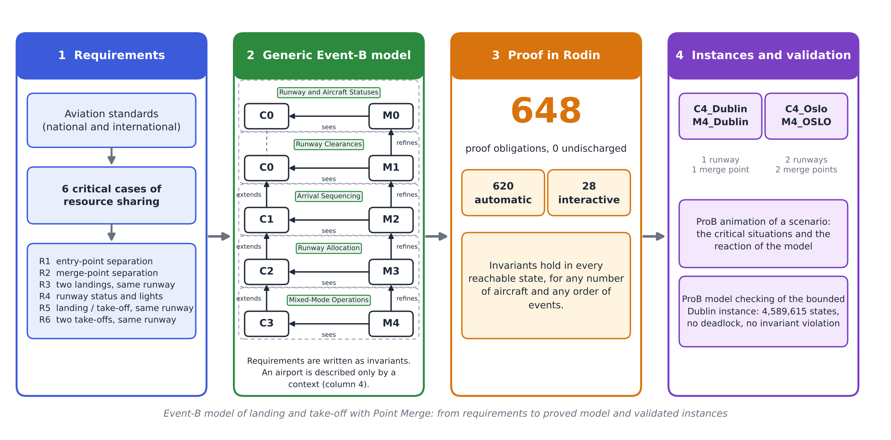
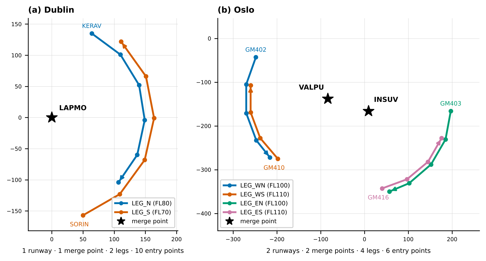

# Event-B model of landing and take-off operations with Point Merge



This repository contains a generic Event-B model of landing and take-off operations in the Terminal Manoeuvring Area (TMA) with Point Merge sequencing, its proofs in Rodin, and two airport instances: Dublin and Oslo.

The safety requirements drawn from aviation standards are formalised as invariants and proved with Rodin. The model is generic: an airport is described only by an instance context, and the machines and the generic contexts are not modified.

## Repository structure

```
Verif/        Rodin project: contexts, machines, proofs
scenarios/    ProB animation scenarios of the six critical cases (captures, traces)
docs/         Figures used in this README
```

## Model

The development is made of five levels. Each machine refines the previous one and sees a context; the contexts extend each other.

| Level | Context | Machine | Content |
|---|---|---|---|
| 0 | `C0` | `M0` | Runway and aircraft statuses |
| 1 | `C0` | `M1` | Runway clearances |
| 2 | `C1` | `M2` | Arrival sequencing |
| 3 | `C2` | `M3` | Runway allocation |
| 4 | `C3` | `M4` | Mixed-mode operations |

## Airport instances

An instance consists of a context that extends `C3` and a machine that sees this context and refines `M4`.

| Airport | Context | Machine | Runways | Merge points | Legs | Entry points |
|---|---|---|---|---|---|---|
| Dublin | `C4_Dublin` | `M4_Dublin` | 1 (`RWY28L`) | 1 (`LAPMO`) | 2 | 10 |
| Oslo | `C4_Oslo` | `M4_OSLO` | 2 (`RWY01L`, `RWY01R`) | 2 (`VALPU`, `INSUV`) | 4 | 6 |



The figure shows the waypoints, the legs and the merge points of each instance, as described in the instance contexts (coordinates in model units).

The separations by wake turbulence category are taken from the literature. The values of `RwySep` and `DepDepSep` are assumptions of the optimisation article used as the source, not values imposed by a standard.

## Model checking of the Dublin instance

`M4_Dublin` is the bounded instance used for ProB model checking. The time is bounded by a constant `Horizon` (1200 s): when it is reached, only the event `end_horizon` remains possible, so that the state space is finite. The instance contains two aircraft, which is the size ProB gives to the abstract set `AIRCRAFTS` by default (preference `DEFAULT_SETSIZE`).

ProB explores all reachable states with the deadlock check and the invariant check (mixed breadth-first and depth-first search):

| Measure | Value |
|---|---:|
| States processed | 4,589,615 |
| Transitions | 10,051,701 |
| Deadlocked states | 0 |
| Invariant violations | 0 |
| Run time | 2,539 s |
| Memory | 11,862 MiB |

This check complements the proofs: the proofs hold for any number of aircraft, whereas the model checking covers this bounded instance only. To animate scenarios with more aircraft, increase `DEFAULT_SETSIZE` in the ProB preferences and reload the machine.

## Animation scenarios

The folder `scenarios/` describes the six critical cases animated with ProB on the Dublin data (requirements R1 to R6), with the captures and the traces that replay them. The paper shows a selection of these captures; the others are in this folder.

## Proofs

All proof obligations are discharged in Rodin: 648 in total, 620 automatically and 28 interactively, with none left undischarged.

| Element | Total | Automatic | Interactive |
|---|---:|---:|---:|
| C0 | 6 | 6 | 0 |
| C1 | 13 | 11 | 2 |
| C2 | 0 | 0 | 0 |
| C3 | 1 | 1 | 0 |
| M0 | 48 | 48 | 0 |
| M1 | 66 | 66 | 0 |
| M2 | 294 | 276 | 18 |
| M3 | 90 | 83 | 7 |
| M4 | 130 | 129 | 1 |
| **Total** | **648** | **620** | **28** |

The instance contexts and machines (`C4_*`, `M4_*`) generate no proof obligations.

## Getting started

1. Install Rodin with the Event-B plug-ins and the ProB plug-in.
2. Import the project: `File` > `Import` > `General` > `Existing Projects into Workspace`, then select the `Verif` folder.
3. Let Rodin build the project. The generated files (`*.bcc`, `*.bcm`, `*.bpo`) are not versioned, and the proof files (`*.bpr`, `*.bps`) are applied to the regenerated proof obligations.
4. To animate an airport, open `M4_Dublin` or `M4_OSLO` with ProB. The animation starts with `SETUP_CONTEXT`, which loads the instance context, followed by `INITIALISATION`.
